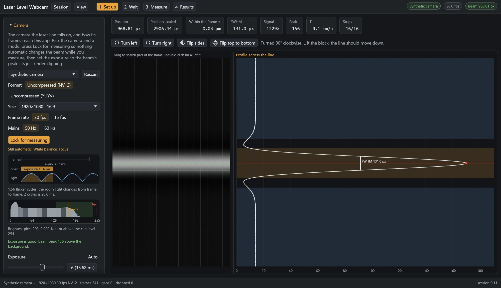
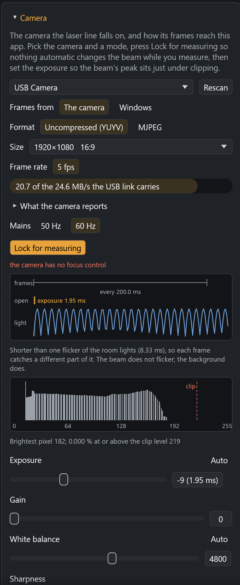
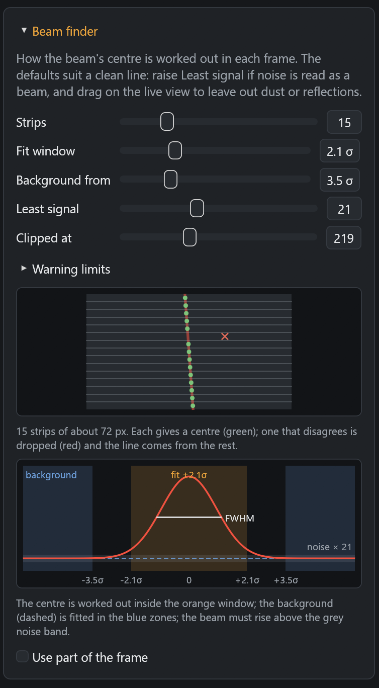
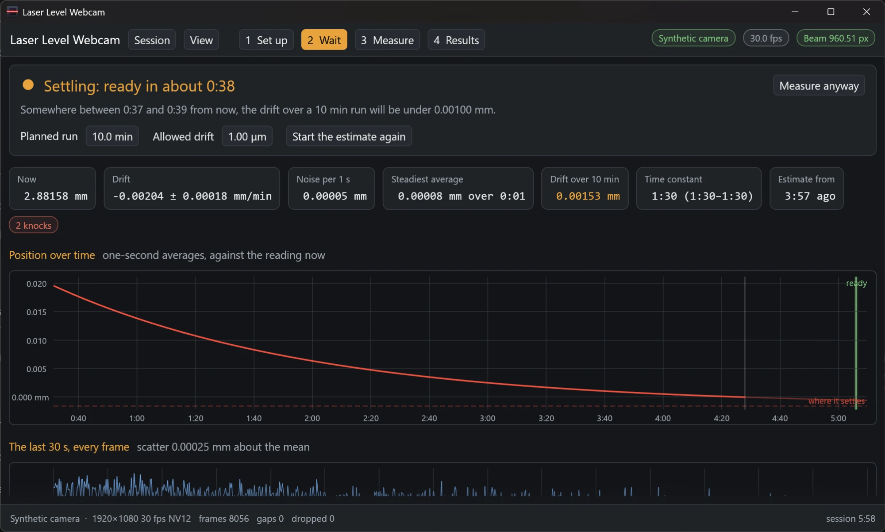
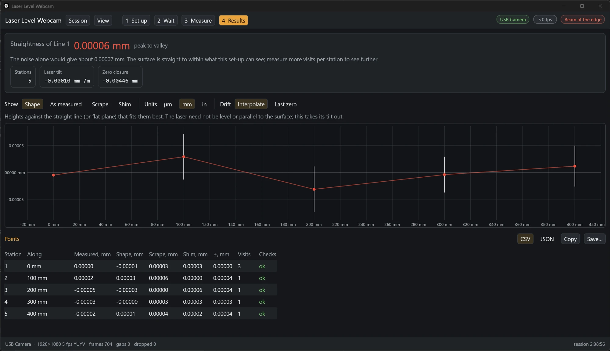
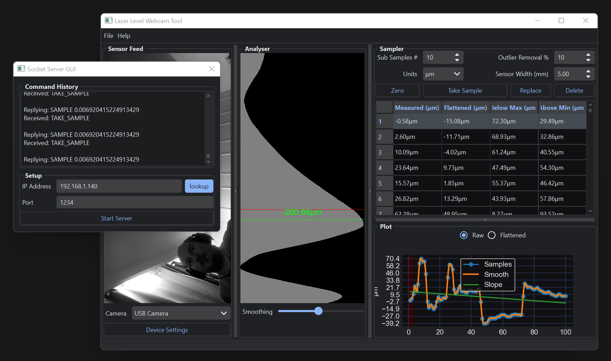
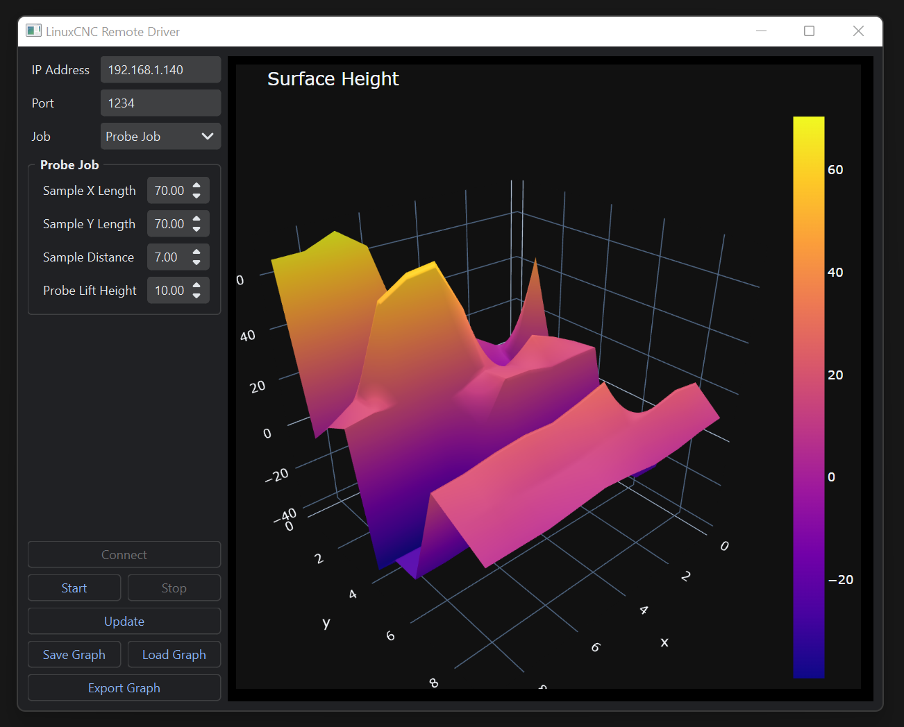

<div align="center">
<h1>LaserVision: Real-time Laser Measurement with a Webcam</h1>



For questions and comments, use the GitHub Discussions tab. Progress reports are also there.

</div>

This software is one half of a measuring tool. You use the tool like a surface plate:

- A laser level makes a line of light.
- A webcam without its lens is on a block. The webcam finds the position of the laser line on its sensor, to less than one pixel.
- You move the block from station to station along a surface. The height of the line at each station gives the straightness or the flatness of the surface.

Until now, the difference between repeated measurements is 0.5 µm to 2 µm.

> **Version 2 is a new program in Rust.** All the sections before [The Python version](#the-python-version-1x) are about version 2. The Python program (version 1.x) is on the [`python` branch](https://github.com/bhowiebkr/laser-level-webcam/tree/python). The last section of this README is about it.

- [How it works](#how-it-works)
- [Getting started](#getting-started)
  - [The Windows app](#the-windows-app)
  - [The Mac app](#the-mac-app)
  - [The Linux app](#the-linux-app)
  - [The browser version](#the-browser-version)
  - [Build from the source code](#build-from-the-source-code)
- [The four steps](#the-four-steps)
  - [1 Set up](#1-set-up), with its sections [Camera](#camera), [Orientation](#orientation), [Sensor](#sensor) and [Beam finder](#beam-finder)
  - [2 Wait](#2-wait)
  - [3 Measure](#3-measure)
  - [4 Results](#4-results)
- [The command-line tool](#the-command-line-tool)
- [Tests](#tests)
- [Tips for good readings](#tips-for-good-readings)
- [The Python version (1.x)](#the-python-version-1x)

---

## How it works

The image sensor of a typical $15 webcam is approximately 5.8 × 3.2 mm. It has 1920 × 1080 pixels. Each pixel is 1 µm to 5 µm. Without the lens, the laser line falls directly on the sensor. You turn the camera on its block until the line crosses the long side of the sensor. The app reads the heights along that side.

In each frame, the beam finder does these steps:

1. It divides the search area of the frame into strips along the line. The default is 16 strips.
2. It calculates the mean of each strip along the line. This gives a profile across the line.
3. It fits the background on the two sides of the beam, away from the beam. Then it calculates the centre of the beam in a window that is a few beam widths wide.
4. It does not use a strip if the centre of that strip does not agree with the other strips. Dust or a reflection can cause this.
5. It fits a straight line through the remaining strips. This line gives the position and the tilt of the laser line.
6. It changes the position from pixels to micrometres. For this, it uses the pixel pitch of the sensor.

Each sample is the mean of the frames during a few seconds. The sample does not use frames without a beam, or frames far from the other frames. The uncertainty of the sample comes from the scatter of its 1-second parts.

All the parts become warmer after you start them. Thus the reading drifts. The Wait step monitors the drift. It tells you when the drift is sufficiently small for the run that you plan. During the measurement, you go back to a zero station at intervals. The app measures the drift at the zero station and removes it from the heights between the visits.

This tool comes from the original [Java tool](https://github.com/betzuka/laserlevel).

## Getting started

You must have:

- A webcam with its lens removed.
- A block with two feet. You put the camera on this block.
- A laser level that makes a line, for example a self-levelling line laser.

> **CAUTION:** Do not touch the sensor. Fingerprints and scratches on the sensor make the readings less accurate.

### The Windows app

The Windows app operates with live cameras on Windows 10 and Windows 11. You can install the app with the installer, or you can use it from the zip file.

To install the app:

1. Download the `.msi` file from [Releases](https://github.com/bhowiebkr/laser-level-webcam/releases).
2. Start the `.msi` file.
3. If Windows shows "Windows protected your PC", click **More info**. Then click **Run anyway**. Windows shows this message because the file has no signature.
4. Follow the steps in the installer. On the features page, you can remove the desktop shortcut and the `PATH` entry, and you can change the folder. When Windows asks for permission to make changes, click **Yes**.
5. On the last page, keep **Start Laser Level Webcam** selected to start the app. You can also start it from the Start menu.

The installer puts the app and the command-line tool `laser` in `C:\Program Files\Laser Level Webcam`. It adds a Start menu shortcut and a desktop shortcut. It also adds the folder to `PATH`, so that `laser` operates in a terminal. Open a new terminal before you use `laser`. A newer installer replaces the installed version.

To remove the app:

1. Open **Settings** > **Apps** > **Installed apps**.
2. Find **Laser Level Webcam**.
3. Click the **⋯** button, then click **Uninstall**.

To use the app without the installer:

1. Download the Windows zip file from [Releases](https://github.com/bhowiebkr/laser-level-webcam/releases).
2. Extract the zip file to a folder.
3. Start `laser-level-webcam.exe`. You do not have to install other software.
4. If Windows shows "Windows protected your PC", click **More info**. Then click **Run anyway**.

The app keeps your settings and the open session when you close the window. They come back when you start the app again.

### The Mac app

The Mac app operates with live cameras on macOS 11 (Big Sur) and newer, on Apple silicon and on Intel Macs. It is one universal app.

1. Download the macOS zip file (`laser-level-webcam-<version>-macos-universal.zip`) from [Releases](https://github.com/bhowiebkr/laser-level-webcam/releases).
2. Open the zip file. Safari opens it for you.
3. Drag **Laser Level Webcam** into the **Applications** folder.
4. Start the app. macOS says that it cannot verify the app, because the app has no Apple developer signature. Click **Done**.
5. Open **System Settings** > **Privacy & Security**. Below **Security**, click **Open Anyway** for Laser Level Webcam. Then click **Open Anyway** again and type your password. You do this only one time.
6. When macOS asks for permission to use the camera, click **Allow**.

Instead of steps 4 and 5, you can remove the download mark in Terminal:

```bash
xattr -dr com.apple.quarantine "/Applications/Laser Level Webcam.app"
```

If you clicked **Don't Allow** for the camera, open **System Settings** > **Privacy & Security** > **Camera** and turn on **Laser Level Webcam**.

The zip file also contains `laser`, the [command-line tool](#the-command-line-tool). The first time that `laser` uses the camera, macOS asks for permission for the terminal app.

The differences from the Windows app are:

- Exposure, white balance and focus offer **Auto** / **lock current value** when AVFoundation reports both modes for that device. Numeric values are unavailable, so these controls have no numeric slider. Devices that expose no controls have **Lock for measuring** disabled.
- **Lock for measuring** reads the exposed modes back. Unlisted controls remain unverified: this API does not provide numeric exposure, gain, sharpness or mains-filter adjustment. Check beam brightness and stability before measuring.
- A saved mode-only lock locks the value current at the next opening; it cannot restore a previous numeric value. In the CLI, `--set exposure=0` locks the current value and `--set exposure=auto` restores automatic exposure.
- macOS supplies NV12 luma, preferring full-range output when available. The **Format** list identifies AVFoundation's source format, which does not establish the camera's USB transport encoding or raw sensor access.
- macOS does not give the USB descriptors. Thus **What the camera reports** is not available, and the app finds a [saved sensor](#sensor) by the name of the camera.

The app holds the device configuration lock while capturing to keep measurement settings stable.
Close other apps using the same camera while measuring. Both executables embed the camera usage
description, so camera access can also be requested when running directly from Cargo.

To check real hardware after building `laser`, run the opt-in check below. Repeat `--camera` for
additional devices; `--all-modes` checks every advertised mode. The script checks auto/lock readback,
reopening, refusal of unsupported numeric settings, frame timing and delivered image dimensions.
It reports frame gaps and deletes temporary images. This checks integration, not measurement accuracy.

```bash
python3 tools/check-macos.py --binary target/debug/laser --camera 'Camera name' --all-modes
```

### The Linux app

The Linux app operates with live cameras through Video4Linux (V4L2) on 64-bit x86 Linux. It needs glibc 2.35 or newer, for example Ubuntu 22.04, Debian 12 or Fedora 36 and newer, and a desktop with X11 or Wayland.

1. Download the Linux file (`laser-level-webcam-<version>-linux-x64.tar.gz`) from [Releases](https://github.com/bhowiebkr/laser-level-webcam/releases).
2. Extract it:

   ```bash
   tar -xzf laser-level-webcam-*-linux-x64.tar.gz
   ```

3. Start the app from the folder:

   ```bash
   ./laser-level-webcam-*-linux-x64/laser-level-webcam
   ```

The folder also contains `laser`, the [command-line tool](#the-command-line-tool), and an icon and a desktop entry. To add the app to the menu of your desktop, copy `laser-level-webcam` to `~/.local/bin`, `laser-level-webcam.png` to `~/.local/share/icons`, and `laser-level-webcam.desktop` to `~/.local/share/applications`.

If the app finds no camera, your user may not have permission to use `/dev/video*`. Add your user to the `video` group, then log out and log in again:

```bash
sudo usermod -aG video "$USER"
```

The Linux app reads the modes, the controls and the USB descriptors of the camera, the same as the Windows app. The exposure value is in steps of 100 µs: 20 is 2 ms.

### The browser version

The browser version is the same app, compiled to WebAssembly. It uses the camera through the browser. It is tested in Chrome on Windows. Edge and other Chromium browsers use the same camera functions. Firefox gives fewer camera controls.

The browser version is one file, `laser-level-webcam-<version>-web.html`. You do not have to install software or start a web server.

1. Download the `.html` file from [Releases](https://github.com/bhowiebkr/laser-level-webcam/releases).
2. Open the file in Chrome or Edge. For example, double-click the file, or drag it into the browser window.
3. When the browser asks for permission to use the camera, click **Allow**.

The differences from the Windows and Linux apps are:

- The browser gives colour frames that it has processed. The app calculates the luma from these frames. The app cannot get the YUYV or MJPEG data from the camera.
- The browser does not give the USB descriptors. Thus **Frames from** and **What the camera reports** are not available.
- The camera controls are the controls that the browser and the camera give: exposure, white balance, brightness, contrast, saturation, sharpness, focus and zoom. Browsers do not give gain or the power line filter.
- In Chrome on Windows, the exposure value is log₂ seconds, the same as in the Windows app.
- **Save…** and **Save session…** download the file. **Open session…** asks for a file.
- The browser keeps your settings, the open session and your [saved sensors](#sensor). If you clear the site data of the browser, the app starts with the default settings and no saved sensors. Use **Export…** in the Sensor section to keep a copy of the sensors.

### Build from the source code

1. Install Rust from [rustup.rs](https://rustup.rs). The repository sets the toolchain version, so rustup gets the correct version.
2. Get the code:

   ```bash
   git clone https://github.com/bhowiebkr/laser-level-webcam.git
   ```

3. Go to the folder:

   ```bash
   cd laser-level-webcam
   ```

4. Build and start the app:

   ```bash
   cargo run --release -p laser-level-webcam
   ```

On Linux, install the libraries for the window before you build. On Ubuntu and Debian, use this command:

```bash
sudo apt install pkg-config libx11-dev libxcursor-dev libxrandr-dev libxi-dev libxkbcommon-dev libwayland-dev libxcb-render0-dev libxcb-shape0-dev libxcb-xfixes0-dev libgl1-mesa-dev
```

On a Mac, install the Xcode command-line tools (`xcode-select --install`).

To build the browser version, you must have the WebAssembly target and [trunk](https://trunkrs.dev):

1. Install the WebAssembly target:

   ```bash
   rustup target add wasm32-unknown-unknown
   ```

2. Install trunk:

   ```bash
   cargo install trunk --locked
   ```

3. Go to the folder of the app:

   ```bash
   cd apps/laser-level-webcam
   ```

4. Build the page, serve it on `http://localhost:8080` and open it:

   ```bash
   trunk serve --release --open
   ```

To make the one-file page for a release, use this command in the repository folder:

```bash
cargo run --release -p pack -- web
```

The command builds the page with trunk. Then it puts the JavaScript and the WebAssembly into the page. The file goes into the `dist` folder.

To build the Windows installer, you must have the [.NET SDK](https://dotnet.microsoft.com/download) and the [WiX Toolset](https://wixtoolset.org) 5:

1. Install the WiX Toolset:

   ```bash
   dotnet tool install --global wix --version 5.0.2
   ```

2. Install the WiX extensions for the installer pages and for the step that starts the app:

   ```bash
   wix extension add --global WixToolset.UI.wixext/5.0.2
   ```

   ```bash
   wix extension add --global WixToolset.Util.wixext/5.0.2
   ```

3. In the repository folder, build the app and the installer:

   ```bash
   powershell -ExecutionPolicy Bypass -File packaging/windows/build-msi.ps1
   ```

The installer goes into the `dist` folder.

To build the Mac zip file with the universal app, use these commands on a Mac. The script signs the app ad hoc.

```bash
rustup target add aarch64-apple-darwin x86_64-apple-darwin
```

```bash
bash packaging/macos/build-app.sh
```

To build the Linux `.tar.gz` file, use this command on Linux:

```bash
bash packaging/linux/build-tar.sh
```

These files also go into the `dist` folder. GitHub Actions builds all the release files for each push to `main` (`.github/workflows/build.yml`). When a version tag is pushed, it makes a draft release with the files.

The app icon (`.ico`, `.png` and the Mac `.icns`) and the pictures in the installer come from code. To make them again, use this command:

```bash
cargo run --release -p pack -- icons
```

## The four steps

Use the tabs along the top from left to right: **1 Set up**, **2 Wait**, **3 Measure**, **4 Results**.

The other items in the top bar are:

- **Session**:
  - **New session** starts a new session without runs. To keep the current session, save it first.
  - **Open session…** opens a saved session.
  - **Save session…** writes all the runs and visits to a JSON file. The file also contains the settings of each measurement.
- **View** sets the size of the UI. Ctrl + and Ctrl − also do this.
- **The chips on the right** show:
  - the camera. This chip is green when the camera is open.
  - the frame rate.
  - the position of the beam in px. This chip is amber when there is a warning. It is red when there is no beam ("Beam at the edge", "Beam too wide", "Beam broken up").

The bar along the bottom shows:

- the camera and its mode.
- the number of frames that the app received.
- **gaps**: frame times without a frame. The camera lost these frames, or an automatic exposure was longer than the frame period.
- **dropped**: frames that this computer did not read because it was too busy.
- the session clock.

### 1 Set up


Use this step to set the camera, the beam and the scale correctly. The column on the left contains the four settings sections below. This column shows only on this step. The remaining part of the screen shows the result of the beam finder for each frame.

**Readouts.** The row along the top:

| Readout | Meaning |
| --- | --- |
| Position | The position where the line crosses the middle of the search area, in frame px from the edge. |
| Position, scaled | The same position in mm, from the scale of the sensor. |
| Within the frame ± | The standard uncertainty from the scatter of the strip centres in this frame. The Wait step measures the noise from frame to frame. |
| FWHM | The width of the beam at half its height. |
| Signal | The peak of the beam divided by the noise of the profile. This readout is amber when it is less than two times the **Least signal** setting. |
| Peak | The height of the beam above the background, in grey levels. |
| Tilt | The angle between the line and the sensor rows. To make the line square to the sensor, turn the camera. |
| Strips | The number of strips whose centres agree with the other strips, out of the number of strips that you set. |

**Warnings.** Chips adjacent to the readouts show a reading that is possibly not correct:

| Warning | Meaning |
| --- | --- |
| Clipped | Pixels in the beam are at full scale. Decrease the exposure, the gain or the laser power. |
| Tilted | The line is not square to the sensor. |
| Near the edge | The fit window is not fully in the frame. Thus the centre comes from the two points at half the height of the beam. If the beam is not symmetrical, these points move the centre. |
| Strips dropped | Some strips gave no centre, or their centre did not agree with the other strips. Possible causes are dust, a reflection or a broken beam. |

**Orientation buttons.** The buttons below the readouts are the same as the buttons in the [Orientation](#orientation) section. Adjacent to them is the sign check for the current orientation.

**Live view.** This shows the frame, turned by the orientation. It shows the search area, its strips and the line that the app found. To search only a part of the frame, drag a rectangle on the view. For example, you can remove dust, a reflection or the edge of the sensor from the search. To search the full frame again, double-click the view.

**Profile across the line.** This shows the mean grey level of each px across the line. The plot is turned 90°, so the peak of the beam is level with the line in the live view. **Around the beam** shows the beam larger. **Whole width** shows the full profile. In the plot:

- the orange band is the fit window.
- the light blue bands are the background zones.
- the blue dashed line is the fitted background.
- the red line is the centre.
- the white bar is the FWHM.
- a red dashed line shows the clip level when the beam is near it.

#### Camera



This section sets the camera that receives the laser line. It also sets how the frames come from the camera to the app.

**Procedure:**

1. Select the camera.
2. Below **Frames from**, select **The camera**.
3. Select **Uncompressed (YUYV)** at the full size of the sensor.
4. Set **Mains** to the frequency of your mains power.
5. Click **Lock for measuring**. This stops all automatic changes to the beam during the measurement.
6. Click **Step the exposure** until the app shows that the exposure is good. The peak of the beam must be just below the clip level.

| Setting | Function |
| --- | --- |
| Camera, Rescan | The camera that the app uses. **Rescan** looks for cameras again, for example after you connect a camera. |
| Frames from | This setting shows only when Windows adds its own modes. **The camera** shows only the modes that the camera sends through the cable. The app reads these modes from the USB descriptors of the camera. **Windows** shows the modes that Windows makes when it decodes the MJPEG frames of the camera (NV12). These modes still contain the JPEG compression, so they are not raw. |
| Format | How the camera sends the pixels. The list shows the uncompressed formats first. **Uncompressed (YUYV)** contains all the pixels from the processor of the camera, without compression. It is the best format for measurements. In this format, large sizes come slowly, because the USB link cannot carry more data. **MJPEG** compresses each frame to a JPEG in the camera, so the full size comes quickly. JPEG uses blocks of 8×8 pixels and can change the shape of the edges of the beam. The app decodes MJPEG itself. |
| Size | The frame size in pixels, and its shape. A size with a different shape can show a different part of the sensor. Refer to **Smaller modes** in [Sensor](#sensor). |
| Frame rate | The frame rates that the camera gives for this format and size. |
| USB link bar | For uncompressed modes, the bar compares the data rate of the mode with the part of the USB link that the camera gets. For example, 1920×1080 YUYV at 5 fps needs 20.7 MB/s, and a USB 2.0 webcam gets 24.6 MB/s. Thus the full size without compression comes only at 5 fps. |
| What the camera reports | The data in the USB descriptors of the camera. This data includes the USB vendor and product IDs, the link speed and the bandwidth. It also includes all the formats, sizes and frame rates that the camera sends. Windows makes all its other modes from these. This part also tells you when the camera has no raw sensor (Bayer) format. Most webcams have no Bayer format. For these webcams, the uncompressed output has the least processing, but it is after the processing in the camera. **Descriptor bytes** shows the raw descriptors. |
| Mains | 50 Hz or 60 Hz. **Lock for measuring** uses this value to set the power line filter. The flicker in the exposure diagram also uses this value. |
| Lock for measuring | Sets all automatic controls to manual, at their current values. Sets gain, sharpness and backlight compensation to their minimum. Sets zoom to off, and sets the mains filter. Controls that are still automatic show in amber below the button. Controls that the camera refused show in red. In the screenshot, the camera has no focus control. |
| Exposure diagram | **frames** is the frame period. **open** is the exposure. **light** is the flicker of the room lights, at two times the mains frequency. The line below the diagram tells you how the exposure fits: (1) Shorter than one flicker: each frame gets a different part of the flicker. The beam does not flicker, but the background flickers. (2) A whole number of flicker cycles: the room light is the same in all frames. (3) Longer than the frame period: the camera becomes slower or drops frames. |
| Histogram | The grey levels of the frame. It shows the peak of the beam and the clip level. The line below it gives the brightest pixel and the percentage of pixels at or above the clip level. **Step the exposure (beam too bright / faint)** moves the exposure one step towards the green band. In this band, the peak is 120 to 230 grey levels above the background. Do this again until the app shows **Exposure is good**. You must lock the exposure first. |
| Camera controls | One slider for each control of the camera, with **Auto** if the camera has it. To see the effect of a control on the reading, put the pointer on the control. **Read the controls again** reads the values from the camera again. |

The usual controls of a webcam, and how to set them for measurements:

| Control | Setting | Reason |
| --- | --- | --- |
| Exposure | Locked, peak just below white | The time that each pixel collects light. If the exposure is too long, the top of the beam clips flat, and the centre is not clear. If the exposure is too short, the beam is lost in the noise. Auto exposure changes the exposure between frames, so the brightness of the beam changes. On Windows, the value is log₂ seconds: −9 is 1/512 s (1.95 ms). On Linux, the value is in steps of 100 µs. |
| Gain | Minimum | Amplification after the pixel. Gain increases the noise together with the signal, so it does not make the reading better. Use the exposure instead. |
| White balance | Locked | Colour gains. The luma of a red beam comes mostly from the red gain. Thus auto white balance changes the brightness of the beam when the room light changes. |
| Power line filter | Your mains frequency, set by **Mains** | This filter is important only with auto exposure. It keeps the exposure at a whole number of flicker periods. With manual exposure, use a whole number of flicker periods (10 ms at 50 Hz, 8.3 ms at 60 Hz). Alternatively, use only the laser to light the target. |
| Sharpness | Minimum | Edge enhancement. It adds dark rings adjacent to the beam. These rings change the width of the beam and cause errors in the background fit. If the beam is not symmetrical, the rings move the centre. |
| Backlight compensation | Off | Makes the dark parts of an image brighter when a bright light is in the image. It changes the shape of the beam profile. |
| Focus | Locked | Without a lens, focus has no effect on the image. But an autofocus motor that moves can shake the sensor. |
| Gamma | The default of the camera | A curve that is not straight moves the centre of a beam that is not symmetrical by a small distance. If the camera has a linear setting, use it. |
| Brightness | Any value | A value added to all grey levels. The beam finder fits the background, so brightness has almost no effect. |
| Contrast | Not too high | Multiplies the grey levels about the middle value. If the contrast is too high, the top of the beam clips. |
| Saturation, Hue | Any value | These controls change only the colour. The luma does not change. |
| Zoom | Off | Digital zoom cuts and enlarges the image. This changes the µm per pixel. |

#### Orientation


This section sets how the camera picture is turned. The laser line must go across the view, so that the app reads heights up and down the view. The beam finder and the sign of the heights follow the orientation.

**Procedure:**

1. Turn the camera on its block until the laser line crosses the long side of the sensor.
2. Turn the view until the line is level.
3. Put a shim below the block, or lift the block. The line must move down the view.
4. If the line moves up, click **Flip top to bottom**.

| Button | Function |
| --- | --- |
| Turn left | Turns the view 90° anticlockwise. |
| Turn right | Turns the view 90° clockwise. |
| Flip sides | Flips the view from left to right. |
| Flip top to bottom | Flips the view from top to bottom. Use this button if the line moves up the view when you lift the block. |

**The diagram:**

- The orange outline is the turned view.
- The blue dot shows the first pixel of the camera (px 0,0). It shows how the picture is turned.
- The red line is the laser line.
- The arrow shows the direction in which the line must move when you lift the block.
- The bar on the right is the range of the height readings, in mm and px.

The line below the diagram gives the same data in words. For example: "Turned 90° clockwise. Heights are read up and down the view, over 5.76 mm." If the view is wider than it is tall, the short side of the sensor reads the heights. Then an amber note gives the range that you get if you turn the camera 90° on the block and then turn the view.

#### Sensor


This section sets the real size of the camera chip. The app uses it to change pixels to micrometres. All readings use this size. If the pixel pitch has an error of 1 %, all heights have an error of 1 %.

**Procedure:**

1. Enter the pixel pitch and the full resolution from the data sheet of the sensor.
2. Set **Smaller modes**. This tells the app if the smaller modes of the camera scale down the full chip or crop a window of it.

| Setting | Function |
| --- | --- |
| Name | The name of the sensor. The app saves the sensor under this name. |
| Pixel pitch | The distance between the centres of the sensor pixels, from the data sheet. The default is 3.00 µm. |
| Full size | The active pixels at the full resolution of the sensor. The default is 1920 × 1080. |
| Smaller modes | How the camera makes a mode that is smaller than the sensor. **Scaled**: the full sensor, scaled down, so one frame pixel covers some sensor pixels. **Cropped**: a window of the sensor, so one frame pixel is one sensor pixel. To find the method of your camera, select a smaller mode. If the picture shows the same scene but smaller, the camera scales. If the picture shows the middle of the scene, larger, the camera crops. |

The line below the settings gives the size of the sensor in mm and the µm for each frame px. **The diagram:**

- On the left is the sensor, to scale. The current frame is orange, and the laser line is red. The arrow shows the direction of the height readings.
- On the right is a close view of the pixels: frame px in orange on sensor px in grey, with a 5 µm scale bar.

The line below the diagram gives the number of sensor px in one frame px.

**Saved sensors:** save each sensor one time. Then you do not have to enter it again. The row at the top of the section keeps a list of sensors.

1. Open the camera, and enter its sensor.
2. Click **Save**. The app saves the sensor for the camera that is open.
3. When that camera opens again, the app selects its sensor. A line in the section tells you the name of the sensor that it selected. If you change the sensor and keep the same camera, the app keeps your changes.

| Control | Function |
| --- | --- |
| Saved | The list of saved sensors. Select a sensor to use it. Hold the pointer on a sensor to see its cameras. |
| Save | Saves the sensor under its name, for the camera that is open. The button shows **Save changes** if you changed a saved sensor. It shows **Save for this camera** if the sensor is saved but not for this camera. A camera has one sensor. Two cameras can have the same sensor. |
| Delete | Removes the sensor from the list. The settings keep the sensor until you change it. |
| Export… | Saves the list to a file, `sensors.json`. Use it to keep a copy, or to move the list to another computer or to the browser version. |
| Import… | Adds the sensors from an exported file. A sensor with the same name is replaced. |

The app finds a camera by its USB vendor and product ID. If the IDs are not known, it uses the name of the camera. The Windows app keeps the list in `%APPDATA%\laser-level-webcam\data\sensors.json`, the Mac app in `~/Library/Application Support/laser-level-webcam/sensors.json`, and the Linux app in `~/.local/share/laser-level-webcam/sensors.json`. The browser version keeps the list in the browser storage. Hold the pointer on the line below the buttons to see where the list is.

#### Beam finder



This section sets how the app calculates the centre of the beam in each frame. Widths are in beam sigmas (σ). The FWHM of the beam is approximately 2.35 σ.

**Procedure:**

1. For a clean line, use the default values.
2. If the app reads noise as a beam, increase **Least signal**.
3. To remove dust or reflections from the search, drag on the live view.

| Setting | Range (default) | Function |
| --- | --- | --- |
| Strips | 1–64 (16) | The app divides the frame into strips along the line. Each strip gives a centre. The app does not use a strip whose centre does not agree with the other strips (dust, a reflection). The tilt of the line comes from the remaining strips. |
| Fit window | 1–5 σ (2.5 σ) | The half width of the window in which the app calculates the centre. A wider window uses more of the beam, and also more of the noise. |
| Background from | 2–8 σ (4 σ) | The app fits the background outside this number of sigmas from the centre. |
| Least signal | 3–50 (10) | If the beam is less than this number of times the noise, the frame gives no reading. |
| Clipped at | 200–255 (254) | The grey level that the app counts as clipped. A clipped beam has a flat top, and its centre is less accurate. |
| Warning limits: Clipped pixels | 0–1 % (0.05 %) | The maximum percentage of the beam pixels that can clip before the app shows a warning. |
| Warning limits: Tilt | 1–100 mm/m (20 mm/m) | If the tilt of the line across the sensor is more than this value, the app shows a warning. |
| Warning limits: Beam width | 5–100 % (60 %) | If the beam is wider than this percentage of the frame, the frame gives no reading. |
| Use part of the frame | off | The app searches only an area of the frame. To make the area, drag on the live view. To use the full frame, double-click the view. **x**, **y**, **w** and **h** set the area accurately. |

**The two diagrams:**

- **Strips** shows the strips across the frame. The centre of each strip is green. A dropped strip is a red ×. The line comes from the remaining strips.
- **Fit zones** shows the profile of a beam. The app calculates the centre in the orange window. It fits the background (dashed) in the blue zones. The beam must be higher than the grey noise band. The height of this band is the noise multiplied by **Least signal**.

### 2 Wait



The camera sensor, the laser and the stand become warmer after you start them. The reading drifts until their temperatures are stable. This step monitors the reading. It tells you when the drift during your planned run will be sufficiently small.

**The banner** at the top shows the state:

| State | Meaning |
| --- | --- |
| Learning the drift | The app collects the readings for the first estimate. The bar shows the progress. |
| Too noisy to tell | From one second to the next, the reading changes more than the allowed drift. Make the stand more stable, put a shield around the beam to stop air movement, or increase the allowed drift. |
| Settling: ready in about … | The drift becomes slower. The banner gives the earliest and the latest time when the drift during the run will be less than the allowed drift. |
| Drifting | The reading moves at the rate shown, and it does not become slower yet. When a set-up becomes warm, the drift becomes slower. If the drift does not stop, a part is loose, or there is a heat source near the set-up. |
| Ready to measure | The expected drift during a run of the planned length is less than the allowed drift. |

**Measure anyway** opens the Measure step before the set-up is ready. When the set-up is ready, the button changes to **Measure**.

| Setting | Function |
| --- | --- |
| Planned run | The time for your measurement: the number of stations multiplied by the time at each station. The default is 10 min. |
| Allowed drift | The maximum drift of the reading during the run. The default is 1 µm. |
| Start the estimate again | Deletes the readings until now. Use it after a knock or after a change to the set-up. |

**The tiles:**

| Tile | Meaning |
| --- | --- |
| Now | The position of the line across the sensor, from the scale of the sensor. |
| Drift | The current rate of change of the reading, with its uncertainty. It comes from a straight line through the last minutes. |
| Noise per 1 s | The scatter of the 1-second means about the drift. The causes are vibration, air movement and camera noise. |
| Steadiest average | The mean over this time gives the most stable reading. This is the bottom of the Allan deviation. A longer mean includes more drift. A sample near this length is best. |
| Drift over N min | The expected drift if the run starts now, compared with the allowed drift. |
| Time constant | This tile shows when the app can calculate the time constant. It is the time in which the remaining drift decreases to 37 %. After three time constants, 5 % of the drift remains. |
| Estimate from | The estimate uses the readings since the first reading, the last knock, or the last restart. |
| knocks | Sudden jumps in the reading. The estimate starts again after each knock. |

**The charts.** **Position over time** shows the 1-second means, compared with the current reading. Before the set-up is ready, it shows when the set-up will be ready. When the set-up is ready, it shows the planned run. **The last 30 s, every frame** shows the reading of each frame and its scatter about the mean. Vibration and knocks show here first.

### 3 Measure


Put the block on each station in sequence and take a sample. The app measures the heights relative to a zero station. Go back to the zero station at intervals. These visits measure the drift, and the app removes the drift from the heights.

**Procedure:**

1. Click **New run**.
2. Select **Along a line** or **Across a surface**. Use **Along a line** for the straightness of a way, a rail or a beam. Use **Across a surface** for the flatness of a table or a plate.
3. Set the number of stations and their spacing. Make the spacing approximately equal to the length of the block. The block is on two feet, and the height of each station is the position of the block.
4. Click **Create**.
5. Put the block on the zero station. Wait until the block is stable.
6. Click **Take sample**, or push the space bar.
7. Move the block to the station that the card shows. Take a sample. Do this step for each station.
8. When the card shows **Measure the zero again**, click **Go to the zero**. Then take a sample at the zero station.
9. To close the run, take the last sample at the zero station.
10. Click **Results**.

**The toolbar:**

- the run selector.
- the name of the run.
- **New run**.
- **Results**, which opens the Results step.

**The station card** shows the station to measure, its position, and **Take sample**. To select a different station, click it on the plot. After that sample, the next station of the plan comes back. Below this are:

- **Each sample**, which sets the time for each reading:
  - **at least** this time (default 2 s).
  - **at most** this time (default 10 s), also if the sample is not accurate enough at that time.
  - if you select **or once good to**, the sample stops when its uncertainty is less than the target.

  A longer sample removes more noise.
- **A chip** that shows the drift state from the Wait step: "Still settling", "Drift not known yet", "Too noisy for the plan" or "Still drifting".
- **The time since the last zero visit**, and the expected drift since then.
- **"Measure the zero again"**, which shows when that drift is more than the allowed drift.
- **Problems** with the last sample, in red. For example: "no frame of the sample had a beam".

**During a sample**, the card shows:

- **Above the zero**: the height relative to the last zero visit, before the app removes the drift.
- **Good to ±**: the standard error of the mean of the sample.
- **Scatter**: the standard deviation of the frames.
- **Frames**: the number of frames used, out of the number of frames received.

**Cancel** stops the sample. **Keep it now** stops the sample early and keeps it. You can do this after the first second.

**Heights so far** shows the height of each station relative to the zero station, without the drift. The bars are ±1 standard error. To select a station, click it.

**Visits** shows all the samples, the newest first:

| Column | Meaning |
| --- | --- |
| # | The number of the visit. |
| Station | The station of the sample. |
| Time | The time of the sample. |
| Height, ± | The height and its uncertainty. A dash shows that there is no height, for example on zero visits. |
| Frames | The number of frames used, out of the number of frames received. |
| Checks | ok, or the problems that the app found. |

**Measure again** replaces a visit. **Delete** removes a visit.

**This run** gives the data for the run:

- **Zero closure**: the distance that the zero station moved between its first and its last visit. This is the drift that the app removes.
- **Drift between zeros**: the drift that the zero visits measured.
- **Repeatability**: the scatter of repeated visits to the same station. If it is much more than the reading uncertainty, the block is not in the same position each time. Possible causes are dirt, burrs, or the way you put the block down.
- **"Finish on the zero to close the run"**: this note shows until the last visit is a zero visit.

**Stations** is below these data. It is closed at first. It changes the plan:

- the name and the position of each station (along, and across on a surface).
- the zero station.
- **Remove**, which deletes the station and its visits.
- **Add a station**.

### 4 Results



This step shows the straightness (a line) or the flatness (a surface) of the run. It also shows how much to scrape or shim at each station.

**The headline** gives the peak-to-valley straightness or flatness. It compares this value with the value that the noise alone gives. Then it tells you one of these results:

- The surface is straight or flat within the limit that this set-up can see. To see smaller errors, measure more visits at each station.
- The shape is real. The headline also gives the part of the value that is uncertain because of the uncertainty of the scale (µm per px).

**The tiles:**

- **Stations**: the stations that have one or more visits.
- **Laser tilt**: the slope of the fitted line. This is the angle between the laser and the surface. On a surface, there are two values: along and across. The app removes the tilt from the shape, so the laser does not have to be level.
- **Repeatability**: this tile shows when stations have repeated visits.
- **Zero closure**: the distance that the zero moved from its first visit to its last visit.

**"Run not closed on the zero"** tells you that the visits after the last zero visit have no drift check.

**Show** selects the heights on the plot:

| Show | Meaning |
| --- | --- |
| Shape | The heights relative to the best straight line (or flat plane) through them. This removes the tilt of the laser. Thus the laser does not have to be level or parallel to the surface. |
| As measured | The heights relative to the zero station, as the laser measured them. The fitted line or plane is dashed. |
| Scrape | The height of each station above the lowest station. This is the metal to remove to make the station lower. |
| Shim | The height of each station below the highest station. This is the shim to put below the station to make it higher. |

**Units** sets µm, mm or in, for this step and for the CSV.

**Drift** sets how the app uses the zero visits to remove the drift:

- **Interpolate** calculates the zero for each reading by interpolation in time, between the zero visits before and after the reading. Use it when the drift is smooth.
- **Last zero** measures each reading relative to the last zero visit before it. Use it when the time between zero visits is long.

**Points** shows all the stations. The columns are:

- Station
- Along (and Across on a surface)
- Measured, Shape, Scrape and Shim heights
- the uncertainty ±
- Visits
- Checks

**The export buttons:**

| Button | Function |
| --- | --- |
| CSV | Selects a table for a spreadsheet: one row for each station, in the unit shown. |
| JSON | Selects all the data in the result, for a script or a different program. This includes the name of the run, the stations, the fitted line or plane, the straightness or flatness, the drift correction, and the repeatability. Heights are in µm and positions are in mm. |
| Copy | Copies the result in the selected format. You can then paste it. |
| Save… | Writes the result in the selected format to a file. In the browser version, the browser downloads the file. |

## The command-line tool

`laser` does the same work without the window. It writes JSON.

| Command | Function |
| --- | --- |
| `camera` | Shows the cameras, or the modes and controls of a camera. Refer to the options below. |
| `find` | Finds the beam in a PGM frame. |
| `synth` | Writes a synthetic frame with a known beam position. |
| `settle` | Uses the heat-drift monitor on a log of `t_s,x` lines. |
| `warm-up` | Writes a synthetic warm-up log. |
| `survey-sim` | Writes a simulated survey of a known surface to a session file. |
| `results` | Gives the straightness or flatness of a run in a session file, with scrape and shim for each station. |

The options of the `camera` command are:

- `--usb` shows what the camera sends, from its USB descriptors. This option also operates while a different program uses the camera. It is not available on macOS.
- `--set id=value` sets a control first.
- `--lock` locks the camera for measuring.
- `--mode WIDTHxHEIGHT[@FPS][:FORMAT]` opens the mode that you specify.
- `--frames N` gets N frames and shows the frame rate from the clock of the camera.
- `--save` writes the last frame to a PGM file.

Examples:

```bash
cargo run --release -p laser -- camera --usb
```

```bash
cargo run --release -p laser -- camera --mode 1920x1080@5:yuyv --lock --save frame.pgm
```

```bash
cargo run --release -p laser -- help
```

## Tests

To run the tests of the Rust code, use this command:

```bash
cargo test --workspace
```

`browser-check` tests the browser camera code in a real browser. It builds a test page with trunk and serves it on this computer. Then it opens the page in Chrome, with permission to use the camera. For each camera, the page does these steps:

1. It opens the camera and reads frames.
2. It sets each control to its minimum, maximum and middle values, to values outside its range, and to automatic.
3. It locks the camera for measuring.
4. It closes the camera and opens it again with the lock.
5. It opens each mode of the camera.

The tool shows each result. To start it, use this command:

```bash
cargo run -p browser-check
```

| Option | Function |
| --- | --- |
| `--fake` | Uses the test camera of the browser, not the real cameras. |
| `--camera <TEXT>` | Tests only the cameras whose names contain this text. |
| `--browser <NAME>` | `chrome` (the default), `edge`, `brave`, or the path to a browser. |
| `--show` | Shows the browser window. |
| `--no-build` | Uses the page from the last build. |
| `--timeout <S>` | Stops after this number of seconds. The default is 600. |

`pack check` tests the one-file page in the same way as a user opens it. It opens the file from its folder in Chrome, with the test camera of the browser. It passes when the app starts and gets frames from the camera. To start it, use this command:

```bash
cargo run --release -p pack -- check
```

| Option | Function |
| --- | --- |
| `<FILE>` | Tests this page. The default is the page in the `dist` folder. |
| `--show` | Shows the browser window. |
| `--timeout <S>` | Stops after this number of seconds. The default is 60. |

## Tips for good readings

- Let all the parts become warm. The Wait step tells you when they are warm.
- Lock the camera for measuring. All automatic functions in the camera move the beam.
- Make sure that no persons walk near the set-up.
- Do not stand during a sample. The sensor senses the movement of your leg muscles. Sit and do not move.
- A self-levelling laser level moves with all vibration. Look for sources of vibration: persons, computers and electronic equipment with fans, HVAC systems, and other equipment.
- Dust on the sensor causes dropped strips. Remove the dust with a blower, or remove that part of the frame from the search.

---

## The Python version (1.x)

The Python program is on the [`python` branch](https://github.com/bhowiebkr/laser-level-webcam/tree/python).

### Webcam sensor GUI


### LinuxCNC remote driver GUI


This video shows the LinuxCNC remote driver:

[](https://www.youtube.com/watch?v=wpInsrcQAus)

[](http://www.youtube.com/watch?v=hnHjrz_inQU)

Version 1.x reads the laser light on the sensor of a webcam without its lens. The sensor is turned 90°, so its long side is vertical. This gives a large range for the beam. It also decreases the noise from power sources, for example the PWM noise of switching power supplies.

The beam can be a point or a horizontal line. A horizontal line is better. The program calculates the mean of each row. This changes the 2D image to a 1D array. Then the program fits a Gaussian curve to the array to find the centre. Then it changes the pixel position to a physical height. For this, it uses the physical size and the resolution of the sensor.

Multisampling, smoothing of the luminosity noise, and removal of outliers by percentage decrease the noise to less than one pixel.

### Install

The package is on PyPI: https://pypi.org/project/laser-level-webcam/

1. Install the latest 1.x version:

   ```shell
   pip install "laser-level-webcam<2"
   ```

2. Start the program:

   ```shell
   laser-level-webcam
   ```

### Build from the source code

1. Get the `python` branch:

   ```sh
   git clone -b python https://github.com/bhowiebkr/laser-level-webcam.git
   ```

2. Go to the folder:

   ```sh
   cd laser-level-webcam
   ```

3. If you do not have virtualenv, install it:

   ```sh
   pip install virtualenv
   ```

4. Make a virtual environment. Use one of these commands:
   - Without LinuxCNC:

     ```sh
     virtualenv venv
     ```

   - With LinuxCNC:

     ```sh
     virtualenv --system-site-packages venv
     ```

5. Activate the virtual environment:

   ```sh
   .\venv\Scripts\activate
   ```

6. Install the packages in `requirements.txt`. Use one of these commands:
   - Without LinuxCNC:

     ```sh
     pip install -r requirements.txt
     ```

   - With LinuxCNC:

     ```sh
     pip install -r requirements.txt -I
     ```

7. Start the program:

   ```sh
   python.exe laser_level_tool/main.py
   ```

### Usage

Use the tool from left to right. The tips in [Tips for good readings](#tips-for-good-readings) also apply. Other tips for version 1.x:

- Use approximately 100 sub-samples. 1000 sub-samples do not give a much better result.
- Remove 50 % of the outliers.
- Set the smoothing to a high value.
- Keep the tool on for a minimum of 5 minutes, so that the temperature of the webcam sensor is stable. The reading drifts while the sensor becomes warm. To find the time for your sensor, start with a cold sensor. Take the same measurement again and again until the samples do not drift. **File > Cyclic measurement** does this.
- Disable auto exposure and auto colour temperature. Disable all the "auto" settings in the device configuration. To open these settings, click the extra attribute button (bottom left).

## License

This project has the MIT License. Refer to the `LICENSE` file.
