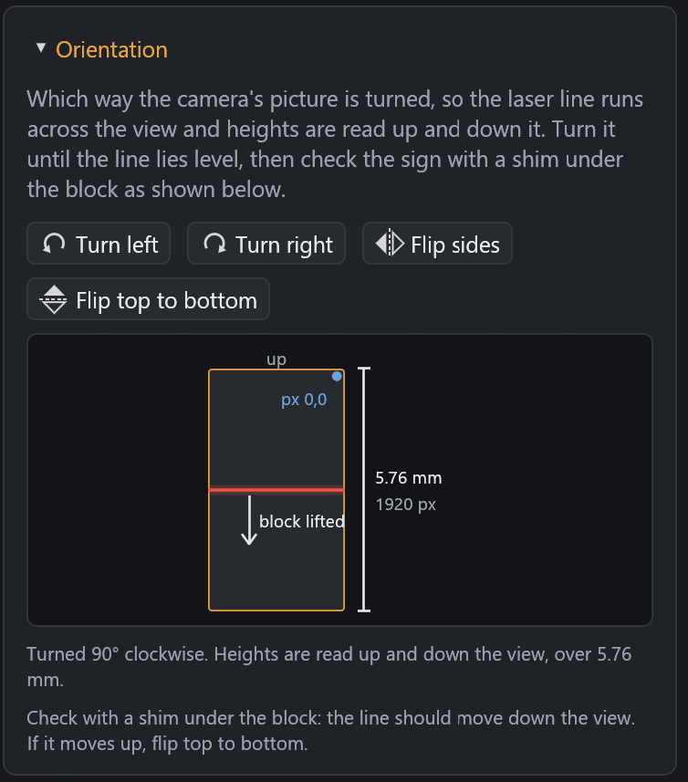
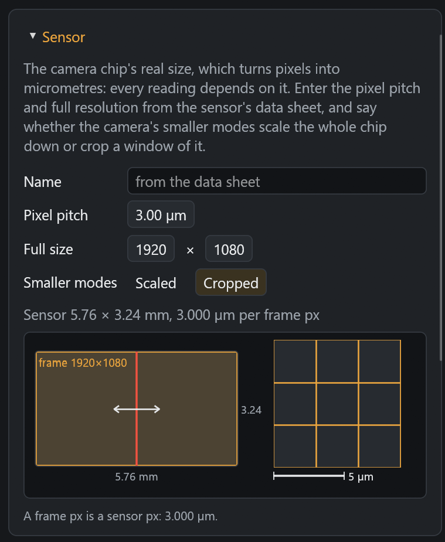
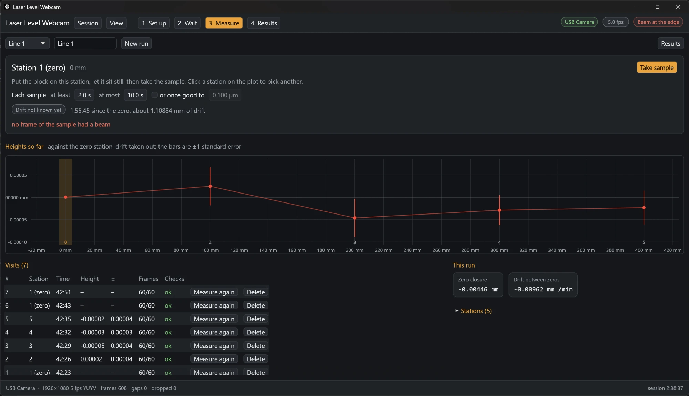

<div align="center">
<h1>LaserVision: Real-time Laser Measurement with a Webcam</h1>


See the GitHub Discussions tab for questions, comments, etc. I'll try to track progress updates over there now.

</div>

This is the software half of a measuring tool used much like a surface plate. A laser level throws a line. A webcam with its lens taken off sits on a block and reads where the line falls on its sensor, to a fraction of a pixel. Move the block from station to station along a surface, and the line's height at each station gives the surface's straightness or flatness. So far, repeated measurements agree to between 0.5 µm and 2 µm.

> **Version 2 is a rewrite in Rust.** Everything below up to [The Python version](#the-python-version-1x) describes it. The Python program (version 1.x) now lives on the [`python` branch](https://github.com/bhowiebkr/laser-level-webcam/tree/python), and is described at the end.

- [How it works](#how-it-works)
- [Getting started](#getting-started)
- [The four steps](#the-four-steps)
  - [1 Set up](#1-set-up), with its sections [Camera](#camera), [Orientation](#orientation), [Sensor](#sensor) and [Beam finder](#beam-finder)
  - [2 Wait](#2-wait)
  - [3 Measure](#3-measure)
  - [4 Results](#4-results)
- [The command-line tool](#the-command-line-tool)
- [Tips for good readings](#tips-for-good-readings)
- [The Python version (1.x)](#the-python-version-1x)

---

## How it works

The image sensor in a typical $15 webcam is about 5.8 × 3.2 mm, with 1920 × 1080 pixels of 1 to 5 µm each. With the lens off, the laser line falls straight onto the sensor. The camera is turned on its block so that the line crosses the sensor's long side, and heights are read along that side.

In each frame the beam finder:

1. Cuts the searched part of the frame into strips along the line (16 by default).
2. Averages each strip along the line into a profile across it. It fits the background on both sides, away from the beam, and works out the beam's centre inside a window a few beam widths wide.
3. Drops strips whose centre disagrees with the rest (dust, a reflection), and fits a straight line through the others. That gives the line's position and its tilt.
4. Turns the position from pixels into micrometres, using the sensor's pixel pitch.

Each sample averages frames over a few seconds. It leaves out frames with no beam or far from the rest, and gets its uncertainty from the scatter of its one-second parts.

Everything warms up after it is switched on, so the reading drifts. The Wait step watches the drift and says when it is small enough for the run you plan. While you measure, you go back to a zero station now and then. The drift seen there is taken out of the heights in between.

This tool grew out of this original [Java tool](https://github.com/betzuka/laserlevel).

## Getting started

You need:

- A webcam with its lens unscrewed. Don't touch the sensor.
- A block with two feet for the camera to sit on.
- A laser level that throws a line, such as a self-levelling line laser.

Live cameras work on Windows 10 and 11. The quickest way to start: download the Windows zip from [Releases](https://github.com/bhowiebkr/laser-level-webcam/releases), unzip it and run `laser-level-webcam.exe`. Nothing else needs installing.

To build it yourself, install Rust from [rustup.rs](https://rustup.rs). The repository pins the toolchain version, so rustup fetches the right one. Then:

```bash
git clone https://github.com/bhowiebkr/laser-level-webcam.git
```

```bash
cd laser-level-webcam
```

```bash
cargo run --release -p laser-level-webcam
```

Your settings and the open session are kept when you close the window, and come back the next time you start it.

## The four steps

Work through the tabs along the top from left to right: **1 Set up**, **2 Wait**, **3 Measure**, **4 Results**.

The rest of the top bar:

- **Session**:
  - **New session** starts again with no runs. Save the current session first to keep it.
  - **Open session…** opens a saved session.
  - **Save session…** writes every run and visit, with the settings they were measured with, to a JSON file.
- **View** sets the UI size. Ctrl + and Ctrl − do the same.
- **The chips on the right** show:
  - the camera, green while it is open;
  - its frame rate;
  - the beam's position in px. This chip is amber when there is a warning, and red when there is no beam ("Beam at the edge", "Beam too wide", "Beam broken up").

The bar along the bottom shows:

- the camera and its mode;
- the frames received;
- **gaps**: frame times with no frame, lost by the camera or by an automatic exposure longer than the frame period;
- **dropped**: frames this computer was too busy to read;
- the session clock.

### 1 Set up


This step gets the camera, the beam and the scale right. The column on the left holds the four settings sections described below. It is only shown on this step. The rest of the screen shows what the beam finder makes of each frame.

**Readouts.** The row along the top:

| Readout | What it is |
| --- | --- |
| Position | Where the line crosses the middle of the searched region, in frame px from the edge. |
| Position, scaled | The same position in mm, from the sensor's scale. |
| Within the frame ± | Standard uncertainty from the scatter of the strip centres in this frame. The Wait step measures the noise from frame to frame. |
| FWHM | Width of the beam at half its height. |
| Signal | The beam's peak over the noise of the profile. Amber when it is under twice the **Least signal** setting. |
| Peak | The beam's height above the background, in grey levels. |
| Tilt | How far the line is from square to the sensor. Turn the camera to square it. |
| Strips | The strips whose centres agree with the others, out of the strips asked for. |

**Warnings.** Chips beside the readouts flag a doubtful reading:

| Warning | What it means |
| --- | --- |
| Clipped | Pixels in the beam are at full scale. Lower the exposure, the gain or the laser power. |
| Tilted | The line is not square to the sensor. |
| Near the edge | The fit window does not fit on the frame. The centre then comes from the half-height crossings, which a lopsided beam pulls. |
| Strips dropped | Some strips gave no centre or disagreed with the rest: dust, a reflection, or a broken beam. |

**Orientation buttons.** The buttons under the readouts are the same ones as in the [Orientation](#orientation) section. Beside them is the sign check for the current orientation.

**Live view.** The frame as the orientation turns it. It shows the searched region, its strips and the line found. Drag a rectangle on it to search only part of the frame, for example to leave out dust, a reflection or the edge of the sensor. Double-click it to search the whole frame again.

**Profile across the line.** The mean grey level of each px across the line. It is drawn on its side, so the beam's peak sits level with the line in the live view. **Around the beam** zooms in on the beam and **Whole width** shows all of it. In the plot:

- the orange band is the fit window;
- the faint blue bands are the background zones;
- the blue dashed line is the fitted background;
- the red line is the centre;
- the white bar is the FWHM;
- a red dashed line marks the clip level when the beam comes near it.

#### Camera


The camera the laser line falls on, and how its frames reach the app.

**To set it up:**

1. Pick the camera.
2. Pick **The camera** under **Frames from**, then **Uncompressed (YUYV)** at the sensor's full size.
3. Set **Mains** to your mains frequency.
4. Press **Lock for measuring**, so nothing automatic changes the beam while you measure.
5. Press **Step the exposure** until it says the exposure is good. The beam's peak should sit just under clipping.

| Setting | What it does |
| --- | --- |
| Camera, Rescan | The camera to use. **Rescan** looks for cameras again, for example after you plug one in. |
| Frames from | Only shown when Windows adds modes of its own. **The camera** lists only what the camera itself sends over the cable, read from its USB descriptors. **Windows** lists the modes Windows makes by decoding the camera's MJPEG (NV12). The JPEG compression is still in those modes: they are not raw. |
| Format | How the pixels travel from the camera. Uncompressed formats are listed first. **Uncompressed (YUYV)** is every pixel as the camera's processor puts it out, with nothing compressed, and is the best for measuring. Large sizes only come slowly, because the USB link carries no more. **MJPEG** compresses each frame to a JPEG in the camera, so full size comes fast. JPEG works in 8×8 blocks and can bend the beam's edges. The app decodes MJPEG itself. |
| Size | Frame size in pixels, and its shape. A size of another shape can show a different part of the sensor; see **Smaller modes** under [Sensor](#sensor). |
| Frame rate | The frame rates the camera lists for this format and size. |
| USB link bar | For uncompressed modes: the data rate the mode needs, against the camera's share of the USB link. For example, 1920×1080 YUYV at 5 fps needs 20.7 of the 24.6 MB/s a USB 2.0 webcam gets. That is why full size uncompressed only comes at 5 fps. |
| What the camera reports | The camera's USB vendor and product IDs, link speed and bandwidth, and every format, size and frame rate it sends, read from its USB descriptors. Anything else Windows lists is made from these. It also says when the camera lists no raw sensor (Bayer) format, as most webcams do. Their least processed output is uncompressed, after the camera's own processing. **Descriptor bytes** shows the raw descriptors. |
| Mains | 50 or 60 Hz. The power line filter that **Lock for measuring** sets follows it, and so does the flicker in the exposure diagram. |
| Lock for measuring | Sets every automatic control to manual at its current value. Turns gain, sharpness and backlight compensation down to their minimum, turns zoom off, and sets the mains filter. Any control still automatic is listed in amber under the button. Any control the camera refused is listed in red; in the screenshot, the camera has no focus control. |
| Exposure diagram | **frames** is the frame period, **open** is the exposure, and **light** is the room lights' flicker, at twice the mains frequency. The line under it says how the exposure fits: (1) Shorter than one flicker: each frame catches a different part of it. The beam does not flicker; the background does. (2) A whole number of flicker cycles: the room light is the same in every frame. (3) Longer than the frame period: the camera slows down or drops frames. |
| Histogram | The grey levels of the frame, with the beam's peak and the clip level marked. The line under it gives the brightest pixel and the share at or above the clip level. **Step the exposure (beam too bright / faint)** moves the exposure one step towards a peak of 120 to 230 grey levels above the background, the green band. Repeat until it says **Exposure is good**. It needs the exposure locked first. |
| Camera controls | One slider for each control the camera has, with **Auto** where the camera offers it. Hover over a control for what it does to the reading. **Read the controls again** reads them back from the camera. |

The controls a webcam usually offers, and how to set them for measuring:

| Control | Set it to | Why |
| --- | --- | --- |
| Exposure | Locked, peak just under white | How long each pixel collects light. Too long and the beam's top clips flat, which hides its centre. Too short and the beam sinks into the noise. Auto exposure changes it between frames, so the beam's brightness wanders. On Windows the value is log₂ seconds: −9 is 1/512 s, 1.95 ms. |
| Gain | Minimum | Amplification after the pixel. It raises the noise with the signal, so it never helps the reading. Use exposure instead. |
| White balance | Locked | Colour gains. A red beam's luma is mostly the red gain, so auto white balance changes the beam's brightness when the room light changes. |
| Power line filter | Your mains, set by **Mains** | Only matters under auto exposure, where it keeps the exposure a whole number of flicker periods. Under manual exposure, pick whole flicker periods (10 ms at 50 Hz, 8.3 ms at 60 Hz), or light the target with the laser only. |
| Sharpness | Minimum | Edge enhancement. It adds dark rings beside the beam, which change its width and upset the background fit. On a lopsided beam they move the centre. |
| Backlight compensation | Off | Brightens the dark parts of a scene with a bright light in it. It reshapes the beam's profile. |
| Focus | Locked | With no lens it does nothing to the image, but an autofocus motor that hunts can shake the sensor. |
| Gamma | The camera's default | Any curve that is not straight moves the centre of a lopsided beam a little. Use a linear setting if the camera has one. |
| Brightness | Anything | An offset added to every grey level. The finder fits the background, so it has little effect. |
| Contrast | Not too high | Scales the grey levels about the middle. Too high clips the beam's top. |
| Saturation, Hue | Anything | Colour only. The luma does not change. |
| Zoom | Off | Digital zoom crops and scales the image, which changes the µm per pixel. |

#### Orientation



Which way the camera's picture is turned. The laser line should run across the view, so that heights are read up and down it. The beam finder and the sign of the heights follow the orientation.

**To set it up:**

1. Turn the camera on its block so the laser line crosses the sensor's long side.
2. Turn the view until the line lies level.
3. Put a shim under the block, or lift it. The line should move down the view. If it moves up, press **Flip top to bottom**.

| Button | What it does |
| --- | --- |
| Turn left | Turns the view 90° anticlockwise. |
| Turn right | Turns the view 90° clockwise. |
| Flip sides | Flips the view left to right. |
| Flip top to bottom | Flips the view top to bottom. Use it when lifting the block moves the line up the view. |

**The diagram:**

- The orange outline is the view as turned.
- The blue dot marks the camera's first pixel (px 0,0), so you can see how the picture was turned.
- The red line is the laser line.
- The arrow shows which way the line should move when the block is lifted.
- The bar on the right is the range heights are read over, in mm and px.

The line under the diagram says the same in words, for example "Turned 90° clockwise. Heights are read up and down the view, over 5.76 mm." If the view is wider than it is tall, the sensor's short side is reading the heights. An amber note then says how far you could read by turning the camera 90° on the block and then turning the view.

#### Sensor



The camera chip's real size, which turns pixels into micrometres. Every reading depends on it: a pixel pitch 1 % off makes every height 1 % off.

**To set it up:** Enter the pixel pitch and full resolution from the sensor's data sheet. Then say whether the camera's smaller modes scale the whole chip down or crop a window of it.

| Setting | What it does |
| --- | --- |
| Name | The sensor's name, for your own records. |
| Pixel pitch | Centre-to-centre distance of the sensor's pixels, from its data sheet. Default 3.00 µm. |
| Full size | The active pixels at the sensor's full resolution. Default 1920 × 1080. |
| Smaller modes | How the camera makes a mode smaller than the sensor. **Scaled**: the whole sensor, scaled down, so a frame pixel covers several sensor pixels. **Cropped**: a window of the sensor, so a frame pixel is a sensor pixel. To find out which yours does, switch to a smaller mode. If the picture shows the same scene, smaller, the camera scales. If it shows a zoomed-in middle, it crops. |

The line under the settings gives the sensor's size in mm and the µm per frame px. **The diagram:**

- On the left, the sensor is drawn to scale. The current frame is in orange, the laser line in red, and the arrow shows the direction heights are read in.
- On the right is a close-up of the pixels: frame px in orange over sensor px in grey, with a 5 µm scale bar.

The line under the diagram says how many sensor px one frame px covers.

#### Beam finder


How the beam's centre is worked out in each frame. Widths are in beam sigmas (σ); the beam's FWHM is about 2.35 σ.

**To set it up:** The defaults suit a clean line. Raise **Least signal** if noise is read as a beam. Drag on the live view to leave out dust or reflections.

| Setting | Range (default) | What it does |
| --- | --- | --- |
| Strips | 1–64 (16) | The frame is cut into strips along the line, and each strip gives a centre. A strip that disagrees (dust, a reflection) is dropped, and the line's tilt comes from the rest. |
| Fit window | 1–5 σ (2.5 σ) | Half width of the window the centre is worked out in. Wider uses more of the beam, and more of the noise. |
| Background from | 2–8 σ (4 σ) | The background is fitted outside this many sigmas from the centre. |
| Least signal | 3–50 (10) | A beam fainter than this many times the noise is no reading. |
| Clipped at | 200–255 (254) | The grey level counted as clipped. A clipped beam has a flat top, and its centre is less sure. |
| Warning limits: Clipped pixels | 0–1 % (0.05 %) | The share of the beam's pixels that may clip before the reading is flagged. |
| Warning limits: Tilt | 1–100 mm/m (20 mm/m) | A line tilted more than this across the sensor is flagged. |
| Warning limits: Beam width | 5–100 % (60 %) | A beam wider than this share of the frame is no reading. |
| Use part of the frame | off | Searches only a region of the frame. Drag on the live view to draw it, and double-click the view for the whole frame. **x**, **y**, **w** and **h** set it exactly. |

**The two diagrams:**

- **Strips** shows the strips across the frame. Each strip's centre is green, a dropped strip is a red ×, and the line comes from the rest.
- **Fit zones** shows a beam's profile. The centre is worked out inside the orange window, and the background (dashed) is fitted in the blue zones. The beam must rise above the grey noise band, which is the noise times **Least signal**.

### 2 Wait


The camera's sensor, the laser and the stand all warm up after they are switched on, and the reading drifts until they settle. This step watches the reading and says when the drift over your planned run will be small enough.

**The banner** at the top gives the state:

| State | What it means |
| --- | --- |
| Learning the drift | Collecting the readings the first estimate needs. The bar shows how far along it is. |
| Too noisy to tell | The reading wanders more from one second to the next than the allowed drift. Steady the stand, shade the beam from air currents, or allow more drift. |
| Settling: ready in about … | The drift is slowing down. It gives the earliest and latest time the drift over the run will be under the allowed drift. |
| Drifting | The reading moves at the rate shown and is not slowing down yet. A set-up that is warming up slows down. One that keeps going has something loose, or a heat source nearby. |
| Ready to measure | The drift expected over a run of the planned length is under the allowed drift. |

**Measure anyway** goes to the Measure step before it is ready. It becomes **Measure** once it is.

| Setting | What it does |
| --- | --- |
| Planned run | How long your measurement will take: stations × the time at each. Default 10 min. |
| Allowed drift | How far the reading may drift over the run. Default 1 µm. |
| Start the estimate again | Forgets the readings so far. Use it after a knock, or a change to the set-up. |

**The tiles:**

| Tile | What it is |
| --- | --- |
| Now | The line's position across the sensor, from the sensor's scale. |
| Drift | How fast the reading moves now, from a straight line through the last minutes, with its uncertainty. |
| Noise per 1 s | The scatter of the one-second averages about the drift: vibration, air currents, camera noise. |
| Steadiest average | Averaging over this long gives the steadiest reading: the bottom of the Allan deviation. Averaging longer lets the drift in. A sample near this length is best. |
| Drift over N min | The drift expected if the run started now, against the allowed drift. |
| Time constant | Shown once it can be told. The time for the drift still to come to fall to 37 %. After three time constants, 5 % is left. |
| Estimate from | The estimate uses the readings since the first one, the last knock, or the last restart. |
| knocks | Sudden jumps in the reading. The estimate starts again after each. |

**The charts.** **Position over time** shows one-second averages against the reading now. It looks ahead to when the set-up will be ready, or across the planned run once it is. **The last 30 s, every frame** shows each frame's reading and its scatter about the mean. Vibration and knocks show up here first.

### 3 Measure



Put the block on each station in turn and take a sample. Heights are measured against a zero station. Going back to the zero now and then measures the drift, which is taken out of the heights.

**To measure a run:**

1. Press **New run**. Pick **Along a line** (straightness of a way, a rail or a beam) or **Across a surface** (flatness of a table or plate). Set the number of stations and their spacing, then press **Create**. Make the spacing about the block's length: the block rests on two feet, and each station's height is where the block sits.
2. Put the block on the zero station, let it sit still, and press **Take sample** (or the space bar).
3. Move to each station the card names and take a sample there.
4. When the card says **Measure the zero again**, press **Go to the zero** and sample it.
5. Finish on the zero to close the run, then press **Results**.

**The toolbar:**

- the run picker;
- the run's name;
- **New run**;
- **Results**, which opens the Results step.

**The station card** names the station to measure and its position, with **Take sample**. Click a station on the plot to pick a different one; the plan's next station comes back after that sample. Below that:

- **Each sample** sets how long each reading is averaged:
  - **at least** this long (default 2 s);
  - **at most** this long (default 10 s), sure enough or not;
  - with **or once good to** ticked, the sample ends early once its uncertainty is below the target.

  Longer samples average away more noise.
- **A chip** carries the drift state from the Wait step: "Still settling", "Drift not known yet", "Too noisy for the plan" or "Still drifting".
- **The time since the last zero visit**, and the drift expected since then.
- **"Measure the zero again"** appears when that drift passes the allowed drift.
- **Problems** with the last sample show in red, for example "no frame of the sample had a beam".

**While a sample runs**, the card shows:

- **Above the zero**: the height against the last zero visit, before the drift is taken out.
- **Good to ±**: the standard error of the sample's mean.
- **Scatter**: the standard deviation of the frames.
- **Frames**: the frames used, out of the frames seen.

**Cancel** stops the sample. **Keep it now** ends it early, after its first second.

**Heights so far** plots each station's height against the zero station, with the drift taken out. The bars are ±1 standard error. Click a station to pick it.

**Visits** lists every sample, newest first:

| Column | What it is |
| --- | --- |
| # | The visit's number. |
| Station | The station sampled. |
| Time | When the sample was taken. |
| Height, ± | The height and its uncertainty. A dash means no height, as on zero visits. |
| Frames | The frames used, out of the frames seen. |
| Checks | ok, or the problems found. |

**Measure again** replaces a visit, and **Delete** removes it.

**This run** gives the run's own figures:

- **Zero closure**: how far the zero station moved between its first and last visit. This is the drift taken out.
- **Drift between zeros**: the drift the zero visits saw.
- **Repeatability**: the scatter of repeat visits to the same station. If it is far above the reading uncertainty, the block does not sit the same way twice: dirt, burrs, or how it is put down.
- **"Finish on the zero to close the run"** shows until the last visit is a zero visit.

**Stations**, folded away under these figures, edits the plan:

- each station's name and position (along, and across on a surface);
- which station is the zero;
- **Remove**, which deletes the station and its visits;
- **Add a station**.

### 4 Results


The run's straightness (a line) or flatness (a surface), with what to scrape or shim at each station.

**The headline** gives the peak-to-valley straightness or flatness. It compares that with what the noise alone would give. Either the surface is straight to within what the set-up can see (measure more visits per station to see further), or the shape is real, and the line says how much of it the scale leaves open.

**The tiles:**

- **Stations**: the stations with at least one visit.
- **Laser tilt**: the slope of the fitted line, which is how far the laser is from parallel to the surface. On a surface there are two: along and across. The tilt is taken out of the shape, so the laser need not be level.
- **Repeatability**: shown when stations have repeat visits.
- **Zero closure**: how far the zero moved from its first visit to its last.

**"Run not closed on the zero"** warns that the visits after the last zero visit have no drift check.

**Show** picks which heights the plot shows:

| Show | What it is |
| --- | --- |
| Shape | Heights against the straight line (or flat plane) that fits them best. The laser need not be level or parallel to the surface; this takes its tilt out. |
| As measured | Heights against the zero station, as the laser saw them, with the fitted line or plane dashed. |
| Scrape | How far each station is above the lowest one: the metal to take off to bring it down. |
| Shim | How far each station is below the highest one: the shim to put under it to bring it up. |

**Units** is µm, mm or in, here and in the CSV.

**Drift** sets how the zero visits take the drift out:

- **Interpolate** interpolates the zero for each reading in time, between the zero visits around it. Use it when the drift is smooth.
- **Last zero** measures each reading against the last zero visit before it. Use it when the zero visits are far apart.

**Points** lists every station. The columns are:

- Station
- Along (and Across on a surface)
- Measured, Shape, Scrape and Shim heights
- the uncertainty ±
- Visits
- Checks

**The export buttons:**

| Button | What it does |
| --- | --- |
| CSV | Picks a table for a spreadsheet: one row per station, in the unit shown. |
| JSON | Picks everything in the result, for a script or another program. That includes the run's name, the stations, the fitted line or plane, the straightness or flatness, the drift correction used, and the repeatability. Heights are in µm and positions in mm. |
| Copy | Copies the result in the picked format, ready to paste. |
| Save… | Writes the result in the picked format to a file. |

## The command-line tool

`laser` does the same work without the window, and prints JSON:

| Command | What it does |
| --- | --- |
| `camera` | Lists the cameras, or shows a camera's modes and controls. See the options below. |
| `find` | Finds the beam in a PGM frame. |
| `synth` | Writes a synthetic frame with a known beam position. |
| `settle` | Runs the heat-drift monitor over a log of `t_s,x` lines. |
| `warm-up` | Writes a synthetic warm-up log. |
| `survey-sim` | Writes a simulated survey of a known surface as a session file. |
| `results` | Gives the straightness or flatness of a run in a session file, with scrape and shim per station. |

The `camera` command's options:

- `--usb` prints what the camera itself sends, read from its USB descriptors. It works while another program streams the camera.
- `--set id=value` sets a control first.
- `--lock` locks the camera for measuring.
- `--mode WIDTHxHEIGHT[@FPS][:FORMAT]` opens a given mode.
- `--frames N` grabs frames and reports the frame rate by the camera's clock.
- `--save` writes the last frame to a PGM file.

```bash
cargo run --release -p laser -- camera --usb
```

```bash
cargo run --release -p laser -- camera --mode 1920x1080@5:yuyv --lock --save frame.pgm
```

```bash
cargo run --release -p laser -- help
```

## Tips for good readings

- Let everything warm up. The Wait step says when it has.
- Lock the camera for measuring. Anything automatic in the camera moves the beam.
- Make sure nobody is walking around.
- Don't stand while taking a sample, because the sensor picks up your leg muscles. Sit and don't move.
- With a self-levelling laser level, anything will make the beam wobble. Look out for people, computers and electronics with fans, HVAC systems, and so on.
- Dust on the sensor shows up as dropped strips. Blow it off, or leave that part of the frame out of the search.

---

## The Python version (1.x)

The Python program lives on the [`python` branch](https://github.com/bhowiebkr/laser-level-webcam/tree/python). The rest of this section is its original README.

### Webcam sensor GUI


### LinuxCNC remote driver GUI


Current version on github has the linuxcnc remove driver seen in this video:
[](https://www.youtube.com/watch?v=wpInsrcQAus)

[](http://www.youtube.com/watch?v=hnHjrz_inQU)

Because of how image sensor technology has progressed, we can use that  as the basis of a highly accurate measurement device. This tool works by reading the laser sensor’s intensity values on a webcam with its camera lens taken off.  An image sensor off a typical $15 webcam is about 3mm wide and has a resolution of FHD (1920x1080). This means that each light sensor is in the range of 1-5 microns in size.

The camera sensor is mounted at 90 degree angle so the wide direction is vertical. This gives a high coverage to sense the beam and also rescues power source based noise like PWM noise in switching power supplies.

The laser beam can be a point or a preferred horizontal line (like in a self leveling laser that I am using). We take the mean of each row (ex 1080 pixels wide) reshaping the 2D image into a 1D array. We then take this 1D array and fit a gaussian curve to it to find the center point. Finally converting the pixel position into physical height from calculations based on the physical size of the sensor to its resolution.

Further improvements reaching sub-pixel noise can be done by multisampling the results, smoothing out the luminosity noise in the 1D array, and removal of outliers by percentage.

This tool is based on the hard work of this original [Java tool](https://github.com/betzuka/laserlevel) but using a different base language Python and further changes to improve its accuracy and usability, and sample speed.

### Install

Binary installer can be downloaded on PyPI https://pypi.org/project/laser-level-webcam/
```shell
pip install laser-level-webcam==1.0.0
```
and than running the command:
```shell
laser-level-webcam
```

### Build from source

Follow these steps to install the Python program:

#### 1. Clone the Repository

Start by cloning the repository's `python` branch, which holds the Python program, to your local machine. Open a terminal and run the following command:

```sh
git clone -b python https://github.com/bhowiebkr/laser-level-webcam.git
```

#### 2. Create a Virtual Environment

Navigate to the cloned repository directory using the cd command:

```sh
cd laser-level-webcam
```

Next, create a virtual environment for isolating the program's dependencies. Run the following commands:

2a. if you are missing virtualenv, install it with pip
```sh
pip install virtualenv
```

**Pick 2b or 2c**

2b. Setup the virtualenv:
```sh
virtualenv venv
```
2c. Setup the virtualenv with support for linuxcnc
```sh
virtualenv --system-site-packages venv
```

#### 3. Activate the Virtual Environment

Activate the virtual environment to start using it.
```sh
.\venv\Scripts\activate
```

#### 4. Install Required Packages

The program's required packages are listed in the requirements.txt file. This will install the packages into the virtual environmnent setup in step 2. To install these packages, run the following command:

**Without linuxcnc support**
```sh
pip install -r requirements.txt
```

**With linuxcnc support**
```sh
pip install -r requirements.txt -I
```

This command uses `pip` to install the packages specified in the requirements.txt file.

#### 5. Run the Python Program
After installing the required packages, you are ready to run the Python program:

```sh
python.exe laser_level_tool/main.py
```
We run the `main.py` file in the `laser_level_tool` directory

### Usage

I’ll make a video explaining this tool and the workflow in greater detail, but in the meantime, work from the left to the right of the tool. Some helpful tips:

- About 100 sub-samples. I tried up to 1000 sub-samples and didn’t find much more of a difference.
- remove 50% of the outliers
- crank the smoothing way up
- let the tool stay on for at least 5 minutes so the webcam sensor stays at a consistent temp. It will drift while getting up to temp. It might be best to test this on your own sensor by taking the same measurement from a cold start and time how long it takes before the samples stop drifting. File->Cyclic measurement feature can be used to achieve this easily.
- Make sure nobody is walking around.
- Don’t stand when taking a sample because it’ll pick up your leg muscles. Sit and don’t move.
- Disable auto exposure and auto color temp. Disable anything that says auto in the device config with the extra attribute button (bottom left)
- If using a self leveling laser level. Anything will make the beam wobble. Look out for sources like people, computers/electronics with fans, HVAC systems, etc.


## License

This project is licensed under the MIT License. See the `LICENSE` file for details.
